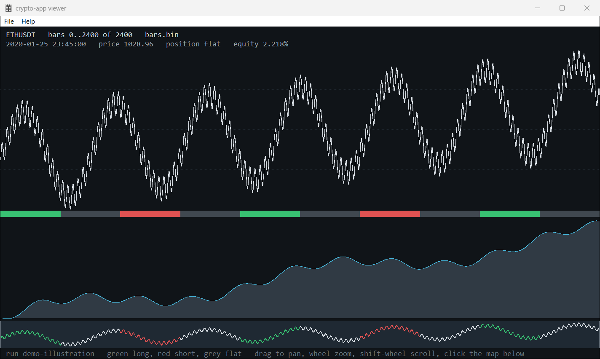

# price-app

[](https://github.com/ZacWalk/price-app/actions/workflows/ci.yml)

**price-app uses a multilayer perceptron (a small neural network) in a Deep
Q-Network (DQN) reinforcement learning (RL) agent to try to predict price
action: after each bar it decides whether to be short, flat or long.**

It is an offline research bench. Given historical OHLC data, walk-forward
experiments measure whether those decisions beat simple rules, baselines and
controls after transaction costs.

The generic input path accepts positive-price OHLC or OHLCV CSVs, with explicit
instrument, currency and session conventions. It does not require crypto trade
flow. Binance trades and klines also have a dedicated acquisition/import path.
This is position prediction, not a future-price, return-probability or live
trading service.



*Synthetic bars and illustrative positions/equity, not investment results.*

- [Design](docs/design.md): the implemented data, prediction and evaluation
  contracts, including limitations.
- [Experiments](docs/experiments.md): measured results, controls, rejected
  hypotheses and reproducible validation experiments. Not a change log.
- [Agent instructions](AGENTS.md): repository development rules.

The recorded market evidence is still limited to ETHUSDT/BTCUSDT perpetuals.
The breakout effect is thin, decaying and underwater at retail fees; on BTC
it loses even at 5 bps. Sadly, the neural network (a DQN) does not beat the
simple rule after costs. Generic input support is **not** evidence of an edge
on another market.

## Two binaries

| Binary | Responsibility |
|---|---|
| `exe\cli.exe` | Import bars, audit features, train/evaluate agents and write experiment artifacts. |
| `exe\app.exe` | Read-only viewing of bars, positions and equity. Never trains or writes. |

The CLI never links platform-h. Experiments and tests are offline;
`cli download` is the only market-data network command.

## Dependencies

Every revision is pinned. The authoritative records are
[cmake/dd-dependencies.json](cmake/dd-dependencies.json) for source
libraries, [vcpkg.json](vcpkg.json) for Windows packages and
[docs/dd-upstream.json](docs/dd-upstream.json) for the build driver. The dd
adoption test fails if this section names a different revision.

### Source libraries

CMake fetches each library at its exact commit and builds it with the project.

| Library | Commit | Linked into | Purpose | Licence |
|---|---|---|---|---|
| [libcmlp](https://github.com/ZacWalk/libcmlp) | `0372c44` | CLI | Multilayer-perceptron math for the DQN agent: binary32 kernels, Adam and checkpoints. | MIT |
| [libcfindata](https://github.com/ZacWalk/libcfindata) | `1aedf4a` | CLI | Binance archive download from `data.binance.vision`, mandatory SHA256 checks and ZIP/CSV validation. | MIT |
| [spike-db](https://github.com/ZacWalk/spike-db) | `062c01e` | Storage benchmark only | Time-series store compared with SPQB bar files. | MIT |
| [platform-h](https://github.com/ZacWalk/platform-h) | `9383d73` | Viewer only (Windows) | Win32 window, drawing, text, input and DPI layer. | MIT |

### Third-party packages

| Package | Windows version | Needed by | Purpose | Licence |
|---|---|---|---|---|
| [libarchive](https://www.libarchive.org) | 3.8.8, default features off | libcfindata | Reading downloaded ZIP archives. | BSD-2-Clause (most files) |
| [OpenSSL](https://www.openssl.org) libcrypto | 3.6.4 | libcfindata | SHA256 verification. | Apache-2.0 |
| [zlib](https://www.zlib.net) | 1.3.2 | libarchive | Deflate decompression. | Zlib |
| [libcurl](https://curl.se/libcurl/) | Not used | libcfindata on Linux | HTTPS transfers; Windows uses WinHTTP. | curl |

On Windows, vcpkg resolves these versions from builtin-baseline `9e44ec0` with
the static `x64-windows-static-md` triplet; its `vcpkg-cmake*` helper ports are
build-time only. Linux uses the distribution's libarchive, OpenSSL and libcurl
development packages at the versions it ships.

Operating-system libraries: the Windows CLI links WinHTTP (through libcfindata)
and BCrypt (through libcmlp), and the storage benchmark PSAPI. The viewer links
the Win32 libraries platform-h requires: user32, gdi32, windowscodecs, comctl32,
comdlg32, shell32, shlwapi, ole32, oleaut32, advapi32, wininet, winhttp and
xaudio2. Linux links libm.

### Tools

| Tool | Version | Role |
|---|---|---|
| [dd](https://github.com/ZacWalk/dd) | 0.2.2, `114890d`, vendored | Build, test and project-command driver: [dd.ps1](dd.ps1) and `.dd/`, hash-checked. |
| CMake | 3.24+ | Configuration and pinned-source acquisition. |
| Ninja | Any | Generator for every preset. |
| MSVC, C++ desktop workload | Visual Studio | Windows C and C++20 compiler. |
| GCC/G++ | Distribution | Linux compiler for the headless CLI. |
| PowerShell | 7.4+ | dd, project commands and test suites. |
| Git | Any | Fetching pinned sources. |
| [vcpkg](https://github.com/microsoft/vcpkg) | Baseline `9e44ec0` | Windows package restore. |
| GitHub Actions | `windows-latest` | CI, using `actions/checkout@v5`, `actions/cache@v4` and `actions/upload-artifact@v4`. |

The tests need nothing else: their fixtures are synthetic and they download no
market data.

## Build and test

Requirements: PowerShell 7.4+, CMake 3.24+, Ninja, Git and Windows/MSVC with the
C++ desktop workload. Linux supports the headless CLI with GCC/G++, PowerShell,
libarchive, OpenSSL and libcurl development packages.

```powershell
.\dd.ps1 dep install --non-interactive
.\dd.ps1 doctor --non-interactive
.\dd.ps1 build release
.\dd.ps1 test --label crypto --non-interactive
```

The `crypto` label selects the project suites in both Debug and Release,
including offscreen-only viewer tests. **Do not use bare `dd test` for unattended
validation**: upstream dd also runs a desktop GUI smoke. Internal target names
are `crypto_cli` and `crypto_app`; Debug executables have a `-d` suffix.

[dd.ps1](dd.ps1) and `.dd/` are immutable upstream bytes; project commands live
in [dd.psd1](dd.psd1) and [cmake/project-command.ps1](cmake/project-command.ps1).
No dependency pin needs changing to use generic data.

### Dependency setup

Set `VCPKG_ROOT` to vcpkg. The presets restore the pinned
[vcpkg.json](vcpkg.json) manifest with `x64-windows-static-md`: static acquisition
libraries and the `/MD` or `/MDd` CRT, not loose OpenSSL DLLs.
[The toolchain wrapper](cmake/vcpkg-toolchain.cmake) prefers `CI_VCPKG_ROOT`
because MSVC environment setup may replace `VCPKG_ROOT`. To retain an explicit
local selection, set `$env:CI_VCPKG_ROOT = $env:VCPKG_ROOT` before dd.
Use fresh CMake caches after changing roots.

To build against a local checkout of a dependency, configure with
`-DCRYPTO_SOURCE_LIBCMLP=<dir>` or the `LIBCFINDATA`, `SPIKE_DB` or
`PLATFORM_H` equivalent. The checkout must be clean at the recorded commit.
The setting is cached; clear it or use a fresh build tree to return to the
pinned download. No sibling checkout is selected implicitly. Build trees
contain `dependency-fingerprint.txt` identifying the sources used.

## Generic OHLC/OHLCV input

Use a single CSV with a header row. Required columns are
`time,open,high,low,close`; `volume` and `session` are optional, and columns
may be reordered.

```csv
time,open,high,low,close,volume,session
1709933400000,100,101,99,100.5,1200,20240308
1709934300000,100.5,102,100,101.5,950,20240308
1710181800000,102,103,101,102.5,1800,20240311
```

This short example illustrates the schema; training needs substantially more
history for indicator warmup and chronological windows.

- `time` is the **bar-open timestamp in UTC epoch milliseconds**. No automatic
  seconds/microseconds or local-time inference is performed.
- Prices must be finite and positive, with consistent OHLC bounds. Rows must
  be ordered, unique and non-overlapping at the declared interval.
- Omit `volume` when unavailable. If supplied, every volume must be finite and
  nonnegative. Missing volume is not treated as observed zero activity.
- With `--calendar utc`, omit `session`; sessions are UTC dates.
- Any other calendar label requires `session`: nonnegative, nondecreasing
  integer IDs, repeated for bars in the same session. The data producer supplies
  these IDs from its calendar. `XNYS`, for example, is a recorded label, **not**
  a built-in holiday/DST calendar.
- Gaps remain gaps. The importer neither fabricates bars across closures nor
  claims to distinguish a closure from missing source data. Validate coverage
  upstream. Generic input is already aggregated; it is not resampled.

```powershell
.\dd.ps1 bars --format ohlcv --in data\raw\example.csv `
    --out data\bars\EXAMPLE-15m.bin --symbol EXAMPLE --interval 15m `
    --calendar XNYS --currency USD --source-name local-csv `
    --price-basis adjusted --yes

.\exe\cli.exe audit --bars data\bars\EXAMPLE-15m.bin

.\exe\cli.exe walk --bars data\bars\EXAMPLE-15m.bin --agent qtable `
    --train 5000 --valid 1000 --gap 2000 --test 1000 `
    --episode 1000 --epochs 2 --seeds 3 --seed 7 --cost-bps 5 --out runs

.\exe\cli.exe patterns --bars data\bars\EXAMPLE-15m.bin --block 26
```

The window sizes are examples, not tuned settings. Select on validation only
and compare matched calendar spans. `patterns --block` is an explicit number
of observed bars for generic data; do not assume 26 suits another interval or
market. Trade-flow and UTC-seasonality studies are explicitly unavailable in
the generic profile.

Generic files use **SPQB v2**, carrying market metadata and session IDs.
They select eleven price-only features plus three position-state columns.
Existing output files are rejected by the generic importer. Binance SPQB v1
files retain their twenty-feature reproduction profile and are not migrated.

Available agents: `flat`, `long`, `short`, `random`, `crossover`, `breakout`,
`qtable`, `dqn`. An ensemble votes across the configured seeds. The native
default is `dqn`; start research with the constants and rules rather than
assuming the most complex agent is better.

## Costs, outputs and limitations

Every experiment reports 1, 2, 5 and 10 bps round-trip costs, plus the requested
cost if different, with shuffled and rotated headline controls. The requested
cost defaults to 5 bps. `--slippage-bps` adds a one-way charge. Generic data
rejects `--cost-activity`: it has no trade counts. The console prints each
variant's break-even round-trip cost (`b/e bps`), then the headline by calendar
year (or month) beside the market return and a rotated timing control inside
each period, so concentration in one period and decay are visible at once.

The decision uses information through a bar's close and applies to the next
observed close, including an overnight gap if present. Fills are modelled at
the decision close plus slippage. Funding, borrow, financing, dividends,
contract rolls, short-sale restrictions and real order execution are **not**
modelled. Adjusted prices are research inputs, not necessarily executable
prices. A positive backtest is not a claim of tradeability.

Each run writes `manifest.txt`, `metrics.csv`, `equity.csv`, a policy where the
agent has one, and `learning.csv` for learners. `equity.csv` records the
out-of-sample ensemble position as `-1`, `0` or `1`. Its timestamp identifies
the input bar; the decision is not available until that bar closes.

```powershell
.\exe\cli.exe list
.\exe\cli.exe report --run <id>
.\exe\cli.exe verify --run <id>
.\exe\app.exe --offscreen --bars data\bars\EXAMPLE-15m.bin --run runs\<id>
```

`verify` checks the data/metadata hash and feature/prediction contract before
re-running the recorded configuration, then requires the rerun's result
artifacts to be byte-identical to the recorded ones (exit 1 otherwise). Generic
annualisation uses the elapsed time of scored transitions; exposure fractions
remain fractions of observed bars. The viewer joins equity to bars by exact
timestamps, including session gaps, and displays currency, calendar and price
basis.

To open a window deliberately:
`.\dd.ps1 app --symbol EXAMPLE --interval 15m --show true`.

## Binance acquisition and reproduction

```powershell
.\dd.ps1 data --kind klines --symbol ETHUSDT --source 1m `
    --from 2024-07-01 --to 2024-07-01 --dry-run
.\dd.ps1 data --kind klines --symbol ETHUSDT --source 1m `
    --from 2024-07-01 --to 2024-07-01 --yes
.\dd.ps1 bars --in data\klines\ETHUSDT\1m --interval 15m --symbol ETHUSDT --yes
```

Binance import detects trades versus klines. Native klines default to their
source interval and can only be aggregated to whole multiples. The dd default
of `10s` is for trades; pass an interval for klines. Daily and monthly archives
land in the same directory: keep only one of them for any date. Overlapping or
repeated rows are refused, never merged.

Downloads support `trades`, `aggTrades`, `klines`, `fundingRate` and `metrics`.
`aggTrades`, `fundingRate` and `metrics` remain raw downloads, not invented feature data.
`--market um|cm|spot` selects acquisition routes; that does not certify their
units for the USD-M reproduction importer. In particular, spot timestamps can
be microseconds and coin-margined volumes are contracts.

SHA256 sidecars and archive/schema checks are mandatory. `--fixtures DIR`
selects offline responses without network fallback; an explicitly empty value
is invalid. A positive `--max-rows` replaces the default 10,000,000 typed-row
limit. Native `--max-archive-bytes` and `--max-csv-bytes` control independent
byte limits. Only missing ZIPs, not missing checksums, may be skipped.

Forced downloads retain the previous CSV as `.previous`, with exclusive
staging and per-destination OS publication locks. Inspect retained `.part` or
`.previous` files after failures; do not remove live writers' `.lock` anchors.
dd booleans take values, for example `--force true`; native CLI switches do not.

Use `.\dd.ps1 commands --json` for command discovery. `experiment --args`
passes a JSON array to `cli walk`; `all` is the explicit Binance pipeline, not a
generic provider selector. Old SPQN DQN checkpoints require their compatible
application revision and are rejected, not converted.

## CI and repository layout

Windows CI runs `dd dep install`, `dd doctor` and the same label-filtered test
command. The suite has ten Windows tests, including two offscreen viewer
tests; the headless Linux suite has eight. Tests use isolated synthetic/local
fixtures, not downloaded market history or persistent runs.

CI needs no repository secrets: every dependency is public and fetched at its
pinned commit, so pull requests from forks run the same checks. Do not use
`pull_request_target`.

CI pre-restores the pinned static vcpkg dependencies with a bounded 30-minute
step and a stable `CI_VCPKG_ROOT`. Its artifacts contain only diagnostic logs
and test reports, never market data or executables. The adoption test checks
this contract.

`src/` contains the predictor and viewer, `tests/` contains offline validation,
and `cmake/` contains dependency/build integration. `build/`, `exe/`,
`vcpkg_installed/`, `data/`, `runs/` and `tmp/` are ignored artifacts. Only source
and documentation belong in commits.

## Licence

price-app is released under the [MIT License](LICENSE). The vendored dd files,
external dependencies and market data are covered in
[THIRD_PARTY_NOTICES.md](THIRD_PARTY_NOTICES.md).
